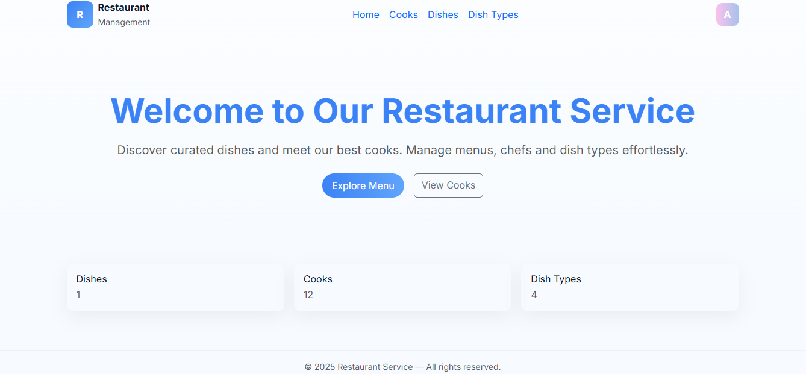

# 🍽️ Restaurant Service Project

A **Django-based web app** for managing dishes, dish types, and cooks in a restaurant.  
Clean structure, intuitive interface, and efficient data handling.


---

## ✨ Features

### 👨‍🍳 Cook Management
- Extends Django’s user model with `years_of_experience`.
- Assign/unassign dishes dynamically.
- Full CRUD via class-based views.

### 🍝 Dish Management
- Manage dishes with name, description, price, and type.
- Many-to-many relation with cooks.
- Search and pagination included.

### 🍽️ Dish Types
- Categorize dishes (e.g., Appetizer, Main Course).
- Search, update, and delete options.

### 🔐 Authentication
- Secure login required for all main pages.
- Each cook manages their own profile.

### 📊 Dashboard
- Shows counts of cooks, dishes, and dish types.
- Tracks number of user visits via session.

---

## 🌐 Live Demo  
👉 [Restaurant Service on Render](https://restaurant-service-t6ff.onrender.com)

**Login:** `adminn`  
**Password:** `adminn`

---

## ⚙️ Installation

```shell
git clone [https://github.com/olegicks/restaurant-service.git](https://github.com/olegicks/restaurant-service.git)
cd restaurant-service
python3 -m venv venv
source venv/bin/activate  # On Windows: venv\Scripts\activate
pip install -r requirements.txt
python manage.py runserver